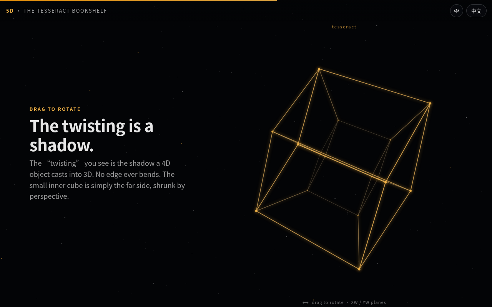
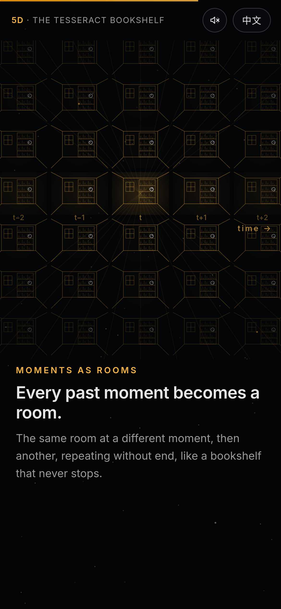

# The Tesseract Bookshelf · 五维书架

> What if time were a place you could walk into? A scroll-driven journey from a single point to a fifth dimension.

**Live:** https://zhangxiaoxi2025.github.io/tesseract-bookshelf/  (English by default; switch to 中文 with the toggle in the top-right)

A one-page scrollytelling piece that builds the intuition for higher dimensions step by step, then arrives at a fan-made, original-art take on the study scene from *Interstellar*. It ends on Brand's line: love is the one thing we're capable of perceiving that transcends dimensions of time and space.

| A tesseract you can drag | Every moment becomes a room |
|---|---|
|  |  |

## The story, act by act

1. **Opening.** A dark screen and one question: *What if time were a place you could walk into?*
2. **0D → 1D → 2D.** A point is dragged into a line, the line is swept into a plane. Then Flatland (Edwin A. Abbott, 1884): when a sphere passes through the plane, a Flatlander only sees a circle appear, swell, shrink and vanish — a slice of something bigger.
3. **3D.** A cube you can drag. Every cube you've ever seen was a 2D projection; a tilted slice of a cube runs triangle → hexagon → triangle. The rule: we only ever meet higher dimensions through shadows and slices.
4. **Time as a dimension.** Lay space flat and let time run upward, and a life becomes a worldline — a long tube, each horizontal slice one "now." The "block universe" view, in which past, present and future all exist together, is shown as one interpretation, not a settled fact.
5. **4D tesseract.** Push a cube into a fourth direction and you get a tesseract (16 corners, 32 edges, 24 square faces, 8 cubes). Drag it; the "twisting" is the shadow a 4D object casts into 3D. No edge ever bends.
6. **5D.** Stand outside all four dimensions of spacetime, and time becomes a direction you can walk along. Every past moment of the same room becomes a cell in an endless bookshelf. An honest note sits here: this is the film's premise, not physics.
7. **The study.** One room, many moments. Tap the timeline to light a moment: books falling in childhood, a figure behind the shelf, a watch ticking Morse, a grown woman reading it years later. Original line art, not a reproduction of any film frame. The Morse shown spells LOOK UP, for illustration.
8. **Film vs reality.** A card that separates settled physics, interpretation, and storytelling. See below.
9. **The watch.** The page closes on a single watch, then Brand's line from *Interstellar* (2014), with a Chinese sense-translation.

## Film vs physics

The page is careful not to blur these together:

- **Settled:** Space and time form a single 4D spacetime, and gravity slows clocks (GPS satellites correct for this). A higher-dimensional shape can only appear to us as a projection or a cross-section.
- **Interpretation:** Relativity says there is no single universal "now." Many physicists take this as support for the block universe; it remains one reading.
- **Theoretical speculation, no experimental evidence so far:** Extra dimensions and a "bulk" that only gravity can cross (brane-world models such as Randall–Sundrum, 1999).
- **Film premise:** Sending a message into the past by tugging on gravity from the bulk; the tesseract room as an artistic rendering of time laid out as space, not a literal four-dimensional tesseract.

The film's science adviser was physicist Kip Thorne (Nobel Prize in Physics, 2017). Further reading: *The Science of Interstellar* (Kip Thorne, 2014); *Flatland* (Edwin A. Abbott, 1884).

## Tech

A single `index.html` file. Open it locally or serve the folder as static files — no build step, no framework, no backend. Animations are drawn with Canvas 2D. Optional sound is off until you turn it on. The page respects `prefers-reduced-motion`, caps canvas resolution, and redraws on width changes only, so iOS toolbar show/hide does not trigger a resize loop.

## Credits & disclaimer

Fan-made educational piece, not affiliated with the film. All artwork is original. The only line quoted from the film is Brand's, and it is attributed (*Interstellar*, 2014).

Made by Xiaoxi Zhang · for everyone who looked up.

## 中文简介

**如果时间是一个可以走进去的地方呢？** 这是一页滚动叙事：从点、线、面讲到立方体、世界线和超立方体，最后走进《星际穿越》里墨菲的书房——每一格都是同一个房间的不同时刻。界面默认英文，右上角可切换到中文。

画面全部为原创线稿，不用电影截图；只引用布兰德那一句台词，并注明出处。页里有一块「电影 vs 现实」卡片：四维时空是定论；块宇宙是一种诠释；只有引力能穿越的「体」（膜宇宙等）是尚无实验证据的理论猜想；书房里的「超立方体」是艺术化表达。电影科学顾问是基普·索恩，可参考他的《The Science of Interstellar》。

单文件 HTML，打开即可，无需构建。

粉丝自制的科普作品，与电影官方无关。

## License

MIT © 2026 Xiaoxi Zhang
